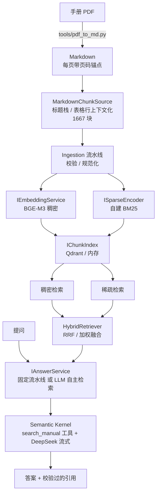

# industrial-docs-rag

面向**工业设备手册**的检索增强问答系统。语料是伺服驱动器手册、CAN 对象字典、PLC 通信协议文档。

> **状态：第 2 个周末 / 共 4 个。** 当前：单文档 **1667 个自动切分的块**、Qdrant 存储、
> **BGE-M3 稠密 + 自建 BM25 稀疏的混合检索**、LLM 自主检索（function calling）。
> 量化评测（Week3）、WPF 界面与引用跳页（Week4）尚未开始。
> 下面所有数字都是在本机实测出来的，不是引用他人结论。

---

## 这类文档难在哪

工业手册的正文只占一小部分，真正被查询的是**寄存器表、对象字典、错误码表**。它们有三个特征让通用 RAG 方案失效：

1. **精确术语是检索目标本身**——用户查的是 `0x6041`、`E201.2`、`H06-08`，而不是"状态字是什么意思"
2. **表格行语义极度稀薄**——`| 6041 | 00 | 状态字 | RO | UINT16 |` 一行十几个字，稠密向量之间几乎没有区分度
3. **同一概念多种写法并存**——同一本手册里 `6041` / `0x6040` / `603Fh` / `2002-03h` 四种形式同时出现

项目的核心主张是：**纯向量检索对这类内容召回极差，必须做混合检索。** 下面是第一份实证。

---

## 实测：为什么必须混合检索

同一份语料（**1667 块**，Qdrant，真实 BGE-M3 + 自建 BM25），同一批问题，
对比三种检索方式下**正确答案的召回排名**（Top-10 之外记为 ✗）：

| 探针问题 | 内容类型 | 稠密（BGE-M3） | 稀疏（BM25） | 混合（RRF） |
|---|---|---|---|---|
| `E201.2 的辅助码是多少` | 故障码行 | ✗ **未进 Top10** | ✓ **第 1（21.14）** | ✓ **第 1** |
| `使用外接制动电阻要注意什么` | 散文段落 | ✓ **第 1** | ✗ **第 4** | ✓ **第 1** |
| `H06-08 速度正向限制的出厂值` | 参数行 | ✓ 第 1（0.753） | ✓ 第 1（37.56） | ✓ 第 1 |
| `0x6041 状态字` | 对象字典行 | ✓ 第 1（0.624） | ✓ 第 1（11.20） | ✓ 第 1 |
| `0x6041 是什么` | 对象字典行 | ✗ 未进 Top10 | ✗ **0 结果** | ✗ 未进 Top10 |

**前两行就是这个项目的全部论点：两种方法恰好在互补的地方失败，混合检索把两边都接住了。**

- **稀疏救精确术语**：`E201.2 的辅助码` 这题，稠密的 Top-3 是 p.127/p.128/p.129 三个**别的**故障码行，
  分数 0.6381 / 0.6272 / 0.6195 —— 上下文化之后同表各行文本 90% 相同，区分它们的恰恰是那几个数字
  token，而稠密向量对数字最不敏感。BM25 对 `0x22010201` 这种全语料只出现一次的词 IDF 极高，直接顶到第 1。
- **稠密救散文与语义**：`制动电阻注意事项` 这题 BM25 的 Top-1 是故障处理表里的一行（词面重合多），
  正确的散文段落掉到第 4；稠密向量第 1 名就对。

**一个必须说清楚的规模效应**：同一道 `E201.2`，在 Week1 的 **15 块**语料下稠密还能排到第 3 名，
到 **1667 块**就跌出了 Top-10。**稠密侧在精确术语上的弱点随语料规模放大** ——
这也说明为什么不能在玩具语料上验证 RAG 方案。

**最后一行是仍然没解决的**：`0x6041 是什么` 三路全败。稀疏侧输在手册索引列写的是 `6041`、
用户打的是 `0x6041`，词面对不上（去掉 `0x` 前缀查 `6041 状态字`，BM25 立刻是第 1 名）；
稠密侧则输在这句话除了记法本身没有任何内容词。**这正是 Week3 术语规范化实验的靶子**，
现在它已经是一个可复现的失败用例，而不是一句猜测。

---

## 架构



项目划分与依赖方向：

| 项目 | 职责 | 依赖 |
|---|---|---|
| `Core` | 领域模型与抽象接口 | **零 NuGet 依赖** |
| `Ingestion` | 读取、校验、入库流水线 | → Core |
| `Retrieval` | 嵌入服务、内存索引、检索器 | → Core |
| `App` | SK 编排、命令行 | → Core / Ingestion / Retrieval |
| `tools/` | 一次性 Python 预处理脚本 | 不入 sln，不算主技术栈 |

**`Core` 保持零 NuGet 依赖是一条硬约束。** 一旦它引入 Semantic Kernel 或 Qdrant，"检索层可替换"就只是一句口号。

**「检索层可替换」现在是被验证过的，不是口号。** Week1 定的 `IChunkIndex` / `IRetriever` 签名
在接入 Qdrant 时**一行没改** —— collection 名、维度这些都通过构造函数注入。当前 `IRetriever` 有
六个实现（内存稠密 / 内存 BM25 / Qdrant 稠密 / Qdrant BM25 / 混合 / 随机对照），换检索器和换存储
后端各是组合根里的一行。

**融合放在客户端而不是用 Qdrant 内置的 Query API**，是因为服务端只支持 RRF 与 DBSF，
做不了 `α·dense + (1-α)·sparse` 的加权融合，而「RRF vs 加权」是 Week3 要做的实验。
客户端融合还有个附带好处：内存路径和 Qdrant 路径共用同一个融合器，**没装 Docker 也能跑通混合检索**。

---

## 当前能做什么

LLM 自主检索（`--answerer agent`）会把一个复合问题拆成多次检索：

```console
$ dotnet run --project src/IndustrialDocsRag.App -- ask     "E201.2 是什么故障？另外 H06-08 这个参数的出厂值是多少？"     --backend qdrant --retriever hybrid --answerer agent

索引   : qdrant/sv660n  (1667 块)
检索器 : hybrid(qdrant-dense:remote:BAAI/bge-m3 + qdrant-sparse:bm25:industrial-v1, rrf)
生成   : deepseek-chat @ https://api.deepseek.com

  → 检索: "E201.2 故障"
  → 检索: "H06-08 出厂值"

**E201.2**：故障名称为 V 相过流，能否复位：否，错误码（603Fh）0x2312，
辅助码（203Fh）为 0x22010201。[sv660n#p129#5-2#832]
**H06-08**：速度正向限制，设定范围 0~6000，出厂值为 6000，最小单位 1rpm。[sv660n#p184#6#1304]

  ← 命中 10 块
```

两次检索的召回集是**累加**的（5 + 5 = 10 块）。这一点非做对不可：如果暂存是覆盖式的，
第一次检索来的那几个引用会在校验时被判成幻觉丢掉。

三个子命令：

| 命令 | 用途 |
|---|---|
| `ingest` | 切分 → 嵌入 → BM25 训练 → 建索引，模型与索引都落盘 |
| `retrieve <查询>` | **只跑检索不接生成**，直接打印召回与分数 |
| `ask <问题>` | 完整问答：检索 → prompt → 流式生成 → 引用表 |

关键开关：

| 开关 | 说明 |
|---|---|
| `--retriever dense \| sparse \| hybrid \| shuffle` | 检索方式。`shuffle` 是对照组，见下文 |
| `--backend memory \| qdrant` | 存储后端。两者检索器种类完全一样，换后端只是一行开关 |
| `--answerer fixed \| agent` | `fixed` 固定检索一次；`agent` 把检索交给 LLM 自主调用 |
| `--fusion rrf \| weighted` + `--alpha` | 融合方式。Week3 的实验维度之一 |
| `--embedder remote \| fake` | `fake` 是离线哈希词袋，无需 API Key 即可跑通整条管道 |
| `--emit-chunks <文件>` | 把切分结果落成 jsonl 供人眼抽样审阅 |
| `--dump-topk <文件>` | 导出召回结果，供 Week3 的 pooling 标注 |

`retrieve` 单独存在是刻意的：检索和生成同时接通再调试，出问题时分不清是召回差还是 prompt 差，那是最烧时间的一类排查。

### 引用会被校验

模型一定会写出格式合法但不存在的编号。答案里的每个 `[chunk-id]` 都会与本轮召回集求交集，**编造的编号被丢弃并单独警告**——不静默吞掉，因为引用幻觉率是衡量 RAG 可信度的直接指标。

### 防自欺的对照实验

`0x6041` 是 CiA402 标准对象，生成模型本来就知道。即使检索完全失效，控制台照样会打出漂亮且正确的答案，让人误以为链路通了。

`--retriever shuffle` 返回随机块作为对照：

```console
$ dotnet run --project src/IndustrialDocsRag.App -- ask "E201.2 的辅助码是多少" --retriever shuffle --seed 2

手册中未找到关于"E201.2"报警码及其辅助码的相关内容。
```

这同时验证三件事：检索真的在起作用、模型没有用通用知识补齐、提示词的"查不到就明说"规则生效。

**Week1 时这条对照本身是不可信的**：随机抽 K 块时特定某块被抽中的概率是 K/N，
15 块 / TopK=5 高达 1/3，实测换 5 个种子有 3 个误抽中了正确块。
现在语料 1667 块，K/N ≈ 0.3%，单跑一次即可采信。

---

## 如何复现

**环境**：.NET 10 SDK、Python 3.13。

### 1. 准备手册

本仓库不含手册 PDF（体积与版权）。测试语料是**《SV660N 系列伺服用户手册-简易版》**（汇川技术，212 页），可从汇川官网下载。放到 `data/sv660n-manual.pdf`。

换用其他手册也可以，但 `tools/pdf_to_md.py` 的页眉页脚规则是照这份手册的版面调的，预期需要重调。

### 2. 预处理

```bash
py -m venv tools/.venv
tools/.venv/Scripts/python.exe -m pip install -r tools/requirements.txt

tools/.venv/Scripts/python.exe tools/pdf_to_md.py data/sv660n-manual.pdf data/sv660n-manual.md
```

Markdown 的切分由 C# 侧的 `MarkdownChunkSource` 完成，不再需要额外脚本。

`data/chunks.jsonl`（Week1 手工挑的 15 块）随仓库提供，**没有手册 PDF 也能跑通全链路**，
只是语料小。完整的 1667 块是 PDF 的衍生物，按版权不入库。

### 3. 配置密钥

密钥只走 user-secrets，不写进任何仓库文件：

```bash
dotnet user-secrets set "Rag:Embedding:ApiKey" "<SiliconFlow key>" --project src/IndustrialDocsRag.App
dotnet user-secrets set "Rag:Chat:ApiKey"      "<DeepSeek key>"    --project src/IndustrialDocsRag.App
```

没有密钥也能跑检索侧：加 `--embedder fake` 用离线哈希词袋。

### 4. 运行

**不装 Docker**（内存索引 + 仓库自带的 15 块 fixture）：

```bash
dotnet run --project src/IndustrialDocsRag.App -- ingest
dotnet run --project src/IndustrialDocsRag.App -- retrieve "0x6041 状态字" --retriever hybrid
dotnet run --project src/IndustrialDocsRag.App -- ask      "E201.2 的辅助码是多少"
dotnet test
```

**完整语料 + Qdrant**（需要手册 PDF 与上一步的 Markdown）：

```bash
docker compose up -d

dotnet run --project src/IndustrialDocsRag.App -- ingest     --input data/sv660n-manual.md --doc-id sv660n --backend qdrant

dotnet run --project src/IndustrialDocsRag.App -- retrieve "E201.2 的辅助码是多少"     --backend qdrant --retriever hybrid

dotnet run --project src/IndustrialDocsRag.App -- ask "E201.2 是什么故障？H06-08 的出厂值呢？"     --backend qdrant --retriever hybrid --answerer agent
```

1667 块的完整入库（含 BGE-M3 远程嵌入与 BM25 训练）实测约 **21 秒**。

---

## 几条工程记录

**表格检测的误判会伪造安全警告。** PyMuPDF 的 `find_tables()` 会把带边框的「警告」提示框也判成表格（212 页里检出 401 张，其中 215 张是误检）。误检的后果不是多几张空表——文字会被按格子打散重排，三条独立的安全警告被拼成一句语义完全错误的话，而原本正确的线性文本因为落在"表格"区域内被丢弃了。这是用坏数据静默替换好数据。已加真实性判定：表头需多列非空且多数数据行填多列，不通过的区域交回线性文本处理。

**对照实验本身也会失效，而且失效的方式是"看起来通过了"。** 第一次跑 shuffle 对照时模型照样答对了。查召回列表才发现随机抽的 5 块里恰好包含正确的那块——随机抽 K 块时特定某块被抽中的概率是 K/N，当前 15 块 / TopK=5 高达 **1/3**。换 5 个种子实测，3 个都误抽中了。已加 `--seed` 并在文档里写明这条对照在 Week2 语料规模前不可单跑定论。

**索引与嵌入服务的兼容性必须硬校验。** 用离线假向量灌了库、换成真实端点后忘记重新 ingest——此时查询向量是真的、库里向量是假的，余弦照样算得出分数、Top-K 照样有结果、答案照样像模像样，但检索完全是噪声。索引文件记录产出它的嵌入服务名与维度，不匹配直接抛异常。

**上下文化表格行是一个权衡，不是纯收益。** 把表格行拼成"表标题 + 章节 + 字段 + 值"能让每行脱离原表也被读懂（生成侧受益），但同表各行因此有 90% 文本完全相同，在向量空间里挤成一团（检索侧受损）。上面那张对比表的第一行就是这个代价的实测：`E201.2` 在 1667 块规模下让稠密侧跌出 Top-10。Week3 会把它作为一个实验维度测量。

**复合表头会静默毁掉 39% 的块。** 参数一览表是三行表头，PDF 转换只认了第一行，真正的列名（`组别` / `索引码` / `参数`）落进了前两个"数据行"，未命名的列被填成 `列2` `列3` 占位符。后果不只是多两条无意义的块——列名丢成 `列3: H06-08` 之后，检索侧就匹配不到"索引码""参数"这些用户真会打的词。实测 678/1737 块受影响。切分器加了三重判据识别表头续行（表头本来就有未命名列、续行末列为空、该行确实提供了列名），并配一条反向守卫测试确保表头完整时不会吞掉数据行。修完 39% → 17%，残留的都是跨列合并表头，内容完整只是列名缺失。

**覆盖区间不能用 `Text.Length` 算。** `TableRow` 的文本是拼装出来的，比源行长得多，用它算 `[CharOffset, CharOffset+Len)` 会一路盖到后面几行——而表格行占语料的 94%，Week3 判命中会系统性误判。为此给 `DocumentChunk` 加了 `SourceLength`，全量 1667 块的偏移都做过复核。

**LF 的单测挡不住 CRLF 的线上数据。** 解析 Markdown 文件头 `<!-- source: xxx.pdf -->` 的正则收尾写成 `-->$`，在单测里全绿——因为 C# 原始字符串字面量是 LF。真实的 `.md` 是 CRLF，多行模式下 `$` 匹配在 `
` 之前、`
` 还留在行尾，匹配直接失败，引用于是指向了中间产物 `.md` 而不是手册 PDF（Week4 的跳页要认 PDF）。补了一条显式构造 CRLF 的回归测试。

---

## 已知局限

- **语料只有 1 份手册**。多文档、增量入库都没做。
- **没有量化评测**。上面的对比表是 5 道探针的定性观察，不是 25 题评测集的召回率——Week3 的内容。
- **术语规范化还没实现**。`0x6041` ↔ `6041` 的记法差异是已确认的失败用例，`ITermNormalizer` 目前是恒等实现。
- **切分残留 17% 的块列名缺失**（跨列合并表头），内容完整但可读性差。
- **BM25 参数未调**。k1=1.2 / b=0.75 是文献默认值，没有针对这份语料调过。
- **只做了最小退避重试**（429/5xx 指数退避三次），没有限流、熔断、超时。
- **`MinScore` 阈值不可用**：实测无关块也能拿到 0.50 的余弦，而正确答案低的只有 0.60，可用阈值区间几乎不存在。
- **Week3 的 pooling 标注有已知偏差**：候选池外的相关块会漏标，导致召回率被系统性高估。

---

## 技术选型

| 环节 | 选择 | 说明 |
|---|---|---|
| 编排 | Semantic Kernel 1.78 (C#) | prompt 模板 + 流式对话 + `search_manual` 工具的 auto-invoke |
| 向量库 | Qdrant 1.18（Docker） | 一个 collection、两个命名向量（`dense` 1024 维余弦 + 稀疏 `bm25`）。点 id 从 chunk id 派生确定性 UUID，原 id 进 payload |
| 稀疏检索 | 自建 BM25 + 自写分词 | 词表 11521 词。分词规则：ASCII 术语整体保留（`0x22010201` / `H06-08` 不拆碎）+ 中文相邻二元组。零 NuGet 依赖 |
| 嵌入 | BGE-M3 @ SiliconFlow | 1024 维，多语言（手册中英混排）。**实测其 OpenAI 兼容端点不返回稀疏向量**，故稀疏侧确定自建 BM25 |
| 生成 | DeepSeek-chat | OpenAI 兼容接口，用 SK 的 OpenAI connector 指向自定义 endpoint 接入 |
| 界面 | WPF + Prism | Week4 |
| PDF 解析 | PyMuPDF（一次性脚本） | 放在 `tools/`，不算主技术栈 |

---

## 路线图

- [x] **Week 1** — 最小闭环：单文档、人工切块、稠密检索、流式问答、引用校验
- [x] **Week 2** — Qdrant + BM25 混合检索、Markdown 自动切分、表格行上下文化、SK function calling
- [ ] **Week 3** — 25 题评测集、Top-5 召回率、参数对比实验（融合方式 / 术语规范化 / 上下文化）
- [ ] **Week 4** — WPF 界面、点击引用跳转原文页码
