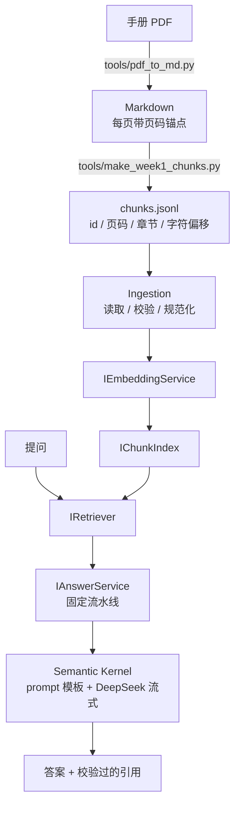

# industrial-docs-rag

面向**工业设备手册**的检索增强问答系统。语料是伺服驱动器手册、CAN 对象字典、PLC 通信协议文档。

> **状态：第 1 个周末 / 共 4 个。** 当前是可运行的最小闭环：单文档、15 个块、纯稠密检索。
> 混合检索（Week2）、量化评测（Week3）、WPF 界面与引用跳页（Week4）尚未开始。
> 下面所有数字都是在本机实测出来的，不是引用他人结论。

---

## 这类文档难在哪

工业手册的正文只占一小部分，真正被查询的是**寄存器表、对象字典、错误码表**。它们有三个特征让通用 RAG 方案失效：

1. **精确术语是检索目标本身**——用户查的是 `0x6041`、`E201.2`、`H06-08`，而不是"状态字是什么意思"
2. **表格行语义极度稀薄**——`| 6041 | 00 | 状态字 | RO | UINT16 |` 一行十几个字，稠密向量之间几乎没有区分度
3. **同一概念多种写法并存**——同一本手册里 `6041` / `0x6040` / `603Fh` / `2002-03h` 四种形式同时出现

项目的核心主张是：**纯向量检索对这类内容召回极差，必须做混合检索。** 下面是第一份实证。

---

## 实测：为什么必须混合检索

同一份语料、同一批问题，对比两种检索方式下**正确答案的召回排名**：

| 问题 | 内容类型 | 词面匹配（哈希词袋） | 稠密向量（BGE-M3） |
|---|---|---|---|
| `0x6041 状态字` | 对象字典行 | ✗ 第 2 名（0.1783） | ✓ **第 1 名（0.6062）** |
| `E201.2 的辅助码是多少` | 故障码行 | ✓ 第 1 名（0.1735） | ✗ **第 3 名（0.6043）** |
| `H06-08 速度正向限制的出厂值` | 参数行 | ✓ 第 1 名（0.3444） | ✓ 第 1 名（0.7799） |
| `使用外接制动电阻要注意什么` | 散文段落 | — | ✓ 第 1 名（0.7881） |

**两种方法恰好在互补的地方失败：**

- **稠密赢在语义**：手册索引列写的是 `6041`，用户打的是 `0x6041`，词面完全对不上；稠密向量靠子词语义接上了。
- **稠密输在精确术语**：`E201.2` 这题前三名是 `E210.0`(0.6295) / `E208.2`(0.6271) / `E201.2`(0.6043)——**正确答案排第三，三者分数跨度只有 0.025**。这些表格行的文本 90% 相同，区分它们的恰恰是那几个数字 token，而稠密向量对数字最不敏感。

这就是 Week2 要引入 BM25 稀疏向量做混合检索的直接依据。

**顺带一个可操作结论**：三次实测中，正确块的检索排名分别是第 2、第 3、第 4 名，**生成侧全部答对**——Top-K 的容错在起作用。因此 Week3 的评测主指标定为 **Recall@5 而非 Recall@1**。

---

## 架构



项目划分与依赖方向：

| 项目 | 职责 | 依赖 |
|---|---|---|
| `Core` | 领域模型与抽象接口 | **零 NuGet 依赖** |
| `Ingestion` | 读取、校验、入库流水线 | → Core |
| `Retrieval` | 嵌入服务、内存索引、检索器 | → Core |
| `App` | SK 编排、命令行 | → Core / Ingestion / Retrieval |
| `tools/` | 一次性 Python 预处理脚本 | 不入 sln，不算主技术栈 |

**`Core` 保持零 NuGet 依赖是一条硬约束。** 一旦它引入 Semantic Kernel 或 Qdrant，"检索层可替换"就只是一句口号。

当前 `IRetriever` 有两个实现——内存余弦检索与随机对照，切换只需改组合根里的一行注册。Week2 加入 Qdrant 混合检索时，接口签名不需要改动：重排也只是一层装饰器，内部把 `TopK` 放大取候选、重排后再截断。

---

## 当前能做什么

```console
$ dotnet run --project src/IndustrialDocsRag.App -- ask "E201.2 的辅助码是多少，能不能复位"

索引   : data/index.week1.json  (15 块, 由 remote:BAAI/bge-m3 产出)
检索器 : dense:remote:BAAI/bge-m3
生成   : deepseek-chat @ https://api.deepseek.com

> E201.2 的辅助码是多少，能不能复位

  → 检索: "E201.2 的辅助码是多少，能不能复位"
  ← 命中 5 块  (0.6680 / 0.6659 / 0.6575 / 0.6235 / 0.5763)

根据手册片段，E201.2 的辅助码为 0x22010201 [sv660n#p129#5-2#000]。
E201.2（V 相过流）的故障类型为 NO.1，能否复位为 否 [sv660n#p129#5-2#000]。

引用：
  [1] sv660n#p129#5-2#000
      sv660n-manual.pdf | p.129 | 第5章 故障处理 > 5.2 通信故障和警告代码一览表
      故障代码一览表（…）| 故障: E201 | 显示: E201.2 | 故障名称: V 相过流 | …
```

三个子命令：

| 命令 | 用途 |
|---|---|
| `ingest` | 读 chunks.jsonl，嵌入后建索引并落盘 |
| `retrieve <查询>` | **只跑检索不接生成**，直接打印召回与分数 |
| `ask <问题>` | 完整问答：检索 → prompt → 流式生成 → 引用表 |

关键开关：

- `--embedder remote|fake` —— `fake` 是离线哈希词袋，无需 API Key 即可跑通整条管道
- `--retriever dense|shuffle` —— `shuffle` 是对照组，见下文
- `--dump-topk <文件>` —— 导出召回结果，供 Week3 的 pooling 标注
- `--seed N` —— 对照实验的随机种子

`retrieve` 单独存在是刻意的：检索和生成同时接通再调试，出问题时分不清是召回差还是 prompt 差，那是最烧时间的一类排查。

### 引用会被校验

模型一定会写出格式合法但不存在的编号。答案里的每个 `[chunk-id]` 都会与本轮召回集求交集，**编造的编号被丢弃并单独警告**——不静默吞掉，因为引用幻觉率是衡量 RAG 可信度的直接指标。

### 防自欺的对照实验

`0x6041` 是 CiA402 标准对象，生成模型本来就知道。即使检索完全失效，控制台照样会打出漂亮且正确的答案，让人误以为链路通了。

`--retriever shuffle` 返回随机块作为对照。用一个确认不含正确答案的种子跑：

```console
$ dotnet run --project src/IndustrialDocsRag.App -- ask "E201.2 的辅助码是多少" --retriever shuffle --seed 2

手册中未找到相关内容。我查到了故障和警告分类的相关说明，
但未涉及 E201.2 故障码及其辅助码的定义 [sv660n#p126#5-1#000]。
```

这同时验证三件事：检索真的在起作用、模型没有用通用知识补齐、提示词的"查不到就明说"规则生效。

---

## 如何复现

**环境**：.NET 10 SDK、Python 3.13。

### 1. 准备手册

本仓库不含手册 PDF（体积与版权）。测试语料是**《SV660N 系列伺服用户手册-简易版》**（汇川技术，212 页），可从汇川官网下载。放到 `data/sv660n-manual.pdf`。

换用其他手册也可以，但 `tools/pdf_to_md.py` 的页眉页脚规则是照这份手册的版面调的，预期需要重调。

### 2. 预处理

```bash
py -m venv tools/.venv
tools/.venv/Scripts/python.exe -m pip install -r tools/requirements.txt

tools/.venv/Scripts/python.exe tools/pdf_to_md.py       data/sv660n-manual.pdf data/sv660n-manual.md
tools/.venv/Scripts/python.exe tools/make_week1_chunks.py data/sv660n-manual.md  data/chunks.jsonl
```

`data/chunks.jsonl` 已随仓库提供，所以这一步可跳过——但脚本保留着，块的来源是可追溯的。

### 3. 配置密钥

密钥只走 user-secrets，不写进任何仓库文件：

```bash
dotnet user-secrets set "Rag:Embedding:ApiKey" "<SiliconFlow key>" --project src/IndustrialDocsRag.App
dotnet user-secrets set "Rag:Chat:ApiKey"      "<DeepSeek key>"    --project src/IndustrialDocsRag.App
```

没有密钥也能跑检索侧：加 `--embedder fake` 用离线哈希词袋。

### 4. 运行

```bash
dotnet run --project src/IndustrialDocsRag.App -- ingest
dotnet run --project src/IndustrialDocsRag.App -- retrieve "0x6041 状态字"
dotnet run --project src/IndustrialDocsRag.App -- ask      "E201.2 的辅助码是多少"
dotnet test
```

---

## 几条工程记录

**表格检测的误判会伪造安全警告。** PyMuPDF 的 `find_tables()` 会把带边框的「警告」提示框也判成表格（212 页里检出 401 张，其中 215 张是误检）。误检的后果不是多几张空表——文字会被按格子打散重排，三条独立的安全警告被拼成一句语义完全错误的话，而原本正确的线性文本因为落在"表格"区域内被丢弃了。这是用坏数据静默替换好数据。已加真实性判定：表头需多列非空且多数数据行填多列，不通过的区域交回线性文本处理。

**对照实验本身也会失效，而且失效的方式是"看起来通过了"。** 第一次跑 shuffle 对照时模型照样答对了。查召回列表才发现随机抽的 5 块里恰好包含正确的那块——随机抽 K 块时特定某块被抽中的概率是 K/N，当前 15 块 / TopK=5 高达 **1/3**。换 5 个种子实测，3 个都误抽中了。已加 `--seed` 并在文档里写明这条对照在 Week2 语料规模前不可单跑定论。

**索引与嵌入服务的兼容性必须硬校验。** 用离线假向量灌了库、换成真实端点后忘记重新 ingest——此时查询向量是真的、库里向量是假的，余弦照样算得出分数、Top-K 照样有结果、答案照样像模像样，但检索完全是噪声。索引文件记录产出它的嵌入服务名与维度，不匹配直接抛异常。

**上下文化表格行是一个权衡，不是纯收益。** 把表格行拼成"表标题 + 章节 + 字段 + 值"能让每行脱离原表也被读懂（生成侧受益），但同表各行因此有 90% 文本完全相同，在向量空间里挤成一团（检索侧受损）。Week3 会把它作为一个实验维度测量。

---

## 已知局限

- **语料只有 1 份手册、15 个块**，且块是人工挑选的。自动切分是 Week2 的内容。
- **只有稠密检索**。BM25 稀疏侧、Qdrant、混合检索融合都还没做。
- **没有量化评测**。上面的对比表是 4 道题的定性观察，不是 25 题评测集的召回率。
- **未做重试、限流、超时**。批量嵌入遇到 429 会直接失败，手动重跑即可。
- **`MinScore` 阈值不可用**：实测无关块也能拿到 0.50 的余弦，而正确答案低的只有 0.60，可用阈值区间几乎不存在。
- **Week3 的 pooling 标注有已知偏差**：候选池外的相关块会漏标，导致召回率被系统性高估。

---

## 技术选型

| 环节 | 选择 | 说明 |
|---|---|---|
| 编排 | Semantic Kernel 1.78 (C#) | 当前只用了 prompt 模板 + 流式对话，份量偏薄；Week2 接入 function calling 后才真正吃到它的能力 |
| 向量库 | Qdrant（Docker） | Week2 引入，看中的是稀疏向量与混合检索能力 |
| 嵌入 | BGE-M3 @ SiliconFlow | 1024 维，多语言（手册中英混排）。**实测其 OpenAI 兼容端点不返回稀疏向量**，故稀疏侧确定自建 BM25 |
| 生成 | DeepSeek-chat | OpenAI 兼容接口，用 SK 的 OpenAI connector 指向自定义 endpoint 接入 |
| 界面 | WPF + Prism | Week4 |
| PDF 解析 | PyMuPDF（一次性脚本） | 放在 `tools/`，不算主技术栈 |

---

## 路线图

- [x] **Week 1** — 最小闭环：单文档、人工切块、稠密检索、流式问答、引用校验
- [ ] **Week 2** — Qdrant + BM25 混合检索、Markdown 自动切分、表格行上下文化、SK function calling
- [ ] **Week 3** — 25 题评测集、Top-5 召回率、参数对比实验（融合方式 / 术语规范化 / 上下文化）
- [ ] **Week 4** — WPF 界面、点击引用跳转原文页码
